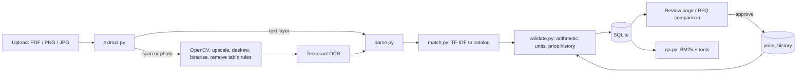

# Architecture

## Decisions and trade-offs

- **Text layer first, OCR second.** A PDF with a text layer is read exactly. OCR is used only when there is no text, and every OCR document goes to human review because a misread digit is indistinguishable from a real error in many cases.
- **Parser repairs OCR digits using arithmetic.** When a number contains characters OCR often confuses with digits (O, U, /, S), the reading is chosen so that qty x rate = amount. If no reading satisfies it, the line is reported as unreadable rather than guessed. Items with all-clean digits are never repaired, so a real arithmetic error in a text PDF stays visible.
- **Scan arithmetic mismatches are labelled `ocr_uncertain`, not `arithmetic_mismatch`**, because in a scan a digit misread is more likely than a supplier error.
- **Catalog matching is TF-IDF over words and character n-grams**, with a penalty when the size in mm differs, so 12mm bars do not match a 16mm description. A reviewer can override the match and the item is re-validated.
- **Price check uses median and MAD of history**, with a 2 percent floor on the scale and a relative band (above 1.3x or below 0.7x) so tiny differences are not flagged. A rate roughly 1000x off is reported as a probable unit error.
- **Approval feeds the baseline, flagged items do not.** Approving a document adds only unflagged items to price history, so one bad quote cannot move what counts as normal.
- **Comparison excludes error-flagged quotes from "cheapest"** and shows like-for-like totals only for materials every supplier quoted cleanly.
- **Question answering uses exact tools for price questions** (SQL over line items) and BM25 retrieval for free text, so a price in an answer always comes from a stored row. With an API key the model chooses tools; any failure falls back to a rule-based router.
- **SQLite and Flask**, one process. Uploads are stored under random names; type and size are checked; filenames are sanitised.
